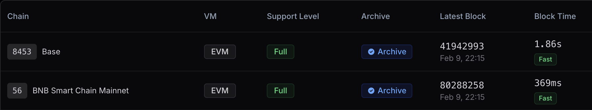

Our core job at RouteMesh is to give you access to every node provider in the crypto ecosystem. With access to a large inventory it means we can:

- Support the most number of chains
- Have the aggregate reliability of all providers
- Be priced in the most economical way

## **Blockchain Support Level**

- **Full**: This means we have more than one provider that can scale up based on demand (outside of a quota based plan).
- **Lite**: only one provider that we have access to.

Networks start at _Lite_. The coverage label describes provider coverage, not a guaranteed
throughput or historical retention depth. If you need additional coverage or a new chain,
contact [support@routeme.sh](mailto:support@routeme.sh) with your requirements. Availability
and timing depend on the providers and capabilities needed for your workload.

## Chain identity and historical requests

The public `GET https://api.routeme.sh/chains/rpc` listing returns each supported RPC
chain's `chain_id` and `name`. Resolve names against that listing rather than treating
an unlabeled numeric row as a name-to-ID mapping. A listing or successful head probe
establishes neither archive availability nor historical retention depth.

To investigate historical access, provide the chain, exact RPC method, target block
or bounded range, and original parameters. State reads, log queries and tracing have
different requirements. A successful request at one block does not establish a universal
retention boundary or prove that an empty log response is complete. If capability has
not been measured for the requested method and block, support will keep it unconfirmed.
